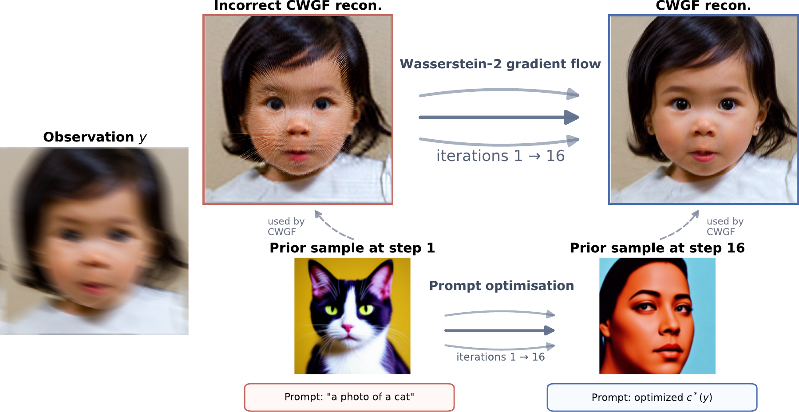

# Official repository for **CWGF**


This repository contains the code for **Consistency Regularised Gradient Flows for Inverse Problems** <https://arxiv.org/abs/2605.07907>.



*Consistency-regularised Wasserstein gradient flow refines the reconstruction while prompt optimisation adapts the generative prior to the observation.*

## Installation
- We use `uv` to manage the environment (Python 3.11). Create the environment with:
```bash
uv venv cwgf --python=3.11
source cwgf/bin/activate
uv pip install -r requirements.txt
```
- The PyPI build of `torch` targets CUDA 13 (NVIDIA driver >= 580). With an older driver, install the CUDA 12.6 build instead:
```bash
uv pip install -r requirements.txt --torch-backend=cu126
```
- Model weights (Stable Diffusion 1.5 and its LCM-LoRA) are downloaded from Hugging Face on the first run. The evaluation scripts also need the datasets: see [`data/README.md`](data/README.md).

## Running Experiments
All scripts are run from the repository root and need one GPU.
- To run for a single image (`data/samples_512/00003.png`, no dataset needed), use:
```bash
bash scripts/single_test.sh
```
- To run the full evaluation (Gaussian deblurring, motion deblurring and x8 super-resolution on FFHQ 512), use:
```bash
bash scripts/eval.sh
```
It processes the first 1000 validation images (set `MAX_NUM_IMAGES` to change this, e.g. `MAX_NUM_IMAGES=10 bash scripts/eval.sh`) and then reports FID, PSNR and LPIPS. Reconstructions are saved in `_exp_eval_*/`.

- For adversarial prompts, use:
```bash
bash scripts/adv_test.sh              # deblur_gauss, deblur_motion and bicubic8
bash scripts/adv_test.sh deblur_gauss # a single degradation
```

- We also include the baselines (LATINO, LDPS, P2L, PSLD, TReg) in `scripts/baselines`, e.g. `bash scripts/baselines/psld.sh`. PSLD can use several GPUs with `NUM_GPUS=2 bash scripts/baselines/psld.sh`.

### Logging to Weights & Biases (optional)
Logging is off by default. To enable it, log in once with `wandb login` (or set `WANDB_API_KEY`), then run any script with `USE_WANDB=true`, e.g. `USE_WANDB=true bash scripts/eval.sh`. Runs are logged to your default W&B entity; set `WANDB_ENTITY=<your team>` to log to a team instead. The W&B project is `exp.name`, set in each script.

## File Structure
- The entry point is `src/main.py`. Scripts for evaluation are provided in `scripts/`.
- `configs` contains the configuration files for different experiments. The main experiment config is `ffhq_stable_diffusion.yaml`.
- `src/algos` contains the implementation of the different algorithms. Our algorithm is implemented in `cwgf_dmd_simple.py` (`algo=cwgf_dmd_s`).
- `src/eval_fid_from_exp.py` recomputes FID / PSNR / LPIPS from the reconstructions of a previous run (same arguments as `src/main.py`).

## Cluster tips (PBS / changing GPU nodes)
Prefetch Stable Diffusion weights once (e.g. on the login node, ~8 GB), then point all jobs at the same folder:

```bash
python scripts/prefetch_sd_weights.py --out /path/to/shared/hf_models
export CWGF_SD_LOCAL_ROOT=/path/to/shared/hf_models
```

The prefetch script creates subfolders named like `local--runwayml--stable-diffusion-v1-5`. Add `--with-sd21`, `--with-dmd2` or `--with-sdxl-lora` for `model=sd21`, `model=dmd2` (used by `scripts/baselines/latino.sh`) or `model=sdxllora`. All scripts in `scripts/` forward `CWGF_SD_LOCAL_ROOT` into `exp.sd_local_root`.

## Citation

If you use this code in your research, please cite our paper:

```bibtex
@misc{spagnoletti2026consistencyregularisedgradientflows,
  title={Consistency Regularised Gradient Flows for Inverse Problems},
  author={Alessio Spagnoletti and Tim Y. J. Wang and Marcelo Pereyra and O. Deniz Akyildiz},
  year={2026},
  eprint={2605.07907},
  archivePrefix={arXiv},
  primaryClass={stat.ML},
  url={https://arxiv.org/abs/2605.07907}
}
```

---

> This repository is based on the implementations of [Repulsive Score Distillation](https://github.com/nzilberstein/Repulsive-score-distillation-RSD-.git) and NVIDIA's [RED-diff](https://github.com/NVlabs/RED-diff). We thank the authors for open-sourcing their code.
